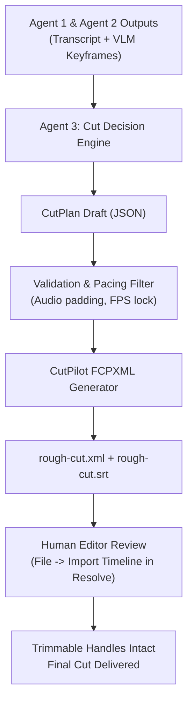

# CutPilot Phase 2 — Editing Tool Interface Specification

**Version:** 1.0.0  
**Status:** Approved Specification  
**Architecture:** Model-Independent, Deterministic Tool Layer  

---

## 1. Overview & Architectural Principles

The CutPilot Editing Tool Interface defines an abstraction layer between LLM decision agents (e.g. Agent 3 / Editing Decision Agent) and non-linear video editing (NLE) environments like DaVinci Resolve.

### Core Principles
1. **Model Independence:** All tools use standard JSON schemas. No tool assumes a specific LLM vendor (Gemini, Claude, GPT, or local Qwen).
2. **Deterministic & Verifiable:** Every editing tool returns structured, verifiable results with explicit frame numbers, timecodes, and file paths.
3. **Safety & Non-Destructive Operation:**
   - Read operations never acquire write locks on NLE databases.
   - Write operations produce versioned, trimmable timeline exchange files (`.fcpxml` / `.srt`), preserving original source assets with full trim handles.
4. **Graceful Fallback:** While DaVinci Resolve Studio supports direct live socket manipulation, DaVinci Resolve Free 21.1+ operates via deterministic FCPXML generation and direct SQLite inspection.

---

## 2. Tool Capability Matrix & Backing Implementations

| # | Tool Name | Mode | DaVinci Resolve Free 21.1+ Implementation | DaVinci Resolve Studio (MCP) Fallback |
|---|---|---|---|---|
| 1 | `inspect_project` | Read | **CutPilot Read-Only SQLite (`Project.db`)** | `davinci-resolve-mcp:inspect_timeline` |
| 2 | `inspect_media` | Read | **CutPilot Read-Only SQLite (`Sm2MpMedia`, `Sm2TiItem`)** | `davinci-resolve-mcp:get_media_pool_items` |
| 3 | `create_timeline` | Write | **CutPilot FCPXML Generator (`rough-cut.xml`)** | `davinci-resolve-mcp:create_timeline` |
| 4 | `import_media` | Write | **FCPXML Resource Binding (`<pathurl>`)** | `davinci-resolve-mcp:import_media` |
| 5 | `apply_timeline_edits` | Write | **CutPilot FCPXML CutPlan Placement** | `davinci-resolve-mcp:apply_edits` |
| 6 | `create_captions` | Write | **CutPilot Subtitle Generator (`.srt` / `.vtt`)** | `davinci-resolve-mcp:create_subtitles` |
| 7 | `apply_clip_transform` | Write | **FCPXML Effect / Motion Transform Element** | `davinci-resolve-mcp:transform_clip` |
| 8 | `configure_render` | Setup | **FCPXML Export Preset / Manual Resolve Preset** | `davinci-resolve-mcp:set_render_settings` |
| 9 | `start_render` | Action | *Human Triggered via Resolve GUI* | `davinci-resolve-mcp:start_render` |
| 10 | `inspect_render_status`| Read | **File Output Polling (Target MP4 inspection)** | `davinci-resolve-mcp:get_render_job_status` |

---

## 3. Tool Specifications & JSON Schemas

### 3.1 `inspect_project`
Reads project metadata, active timelines, framerate, and sequence parameters.

- **Parameters:**
  ```json
  {
    "type": "object",
    "properties": {
      "project_name": {
        "type": "string",
        "description": "Name of the target project (e.g. 'chaitu'). Defaults to active project."
      }
    }
  }
  ```
- **Returns:**
  ```json
  {
    "status": "success",
    "project": {
      "name": "chaitu",
      "id": "a82b5384-a4cc-4ab9-90f8-1f7a3e822566",
      "version": 17,
      "current_timeline": "Timeline 1"
    },
    "timelines": [
      {
        "id": "5823925e-5c45-4c54-a403-0df9ca3ce6a4",
        "name": "Timeline 1",
        "modified_at": 1792331147
      }
    ]
  }
  ```

---

### 3.2 `inspect_media`
Enumerates media items, file paths, video resolutions, frame rates, and durations.

- **Parameters:**
  ```json
  {
    "type": "object",
    "properties": {
      "project_name": { "type": "string" },
      "include_timeline_clips": { "type": "boolean", "default": true }
    }
  }
  ```
- **Returns:**
  ```json
  {
    "status": "success",
    "media_pool": [
      {
        "name": "main-chaitu.mp4",
        "type": "Sm2MpVideoClip",
        "file_path": "C:\\Users\\yoges\\Downloads\\main-chaitu.mp4"
      }
    ],
    "timeline_clips": [
      {
        "name": "main-chaitu.mp4",
        "start_frame": 969,
        "duration_frames": 422,
        "in_frame": 0
      }
    ]
  }
  ```

---

### 3.3 `create_timeline` & `apply_timeline_edits`
Assembles multi-track cut plans into trimmable timelines.

- **Parameters:**
  ```json
  {
    "type": "object",
    "required": ["sequence_name", "fps", "width", "height", "segments", "sources"],
    "properties": {
      "sequence_name": { "type": "string" },
      "fps": { "type": "number", "description": "e.g. 24, 25, 30, 60" },
      "width": { "type": "integer", "default": 1920 },
      "height": { "type": "integer", "default": 1080 },
      "sources": {
        "type": "array",
        "items": {
          "type": "object",
          "properties": {
            "source_id": { "type": "integer" },
            "path": { "type": "string" },
            "duration": { "type": "number" }
          }
        }
      },
      "segments": {
        "type": "array",
        "items": {
          "type": "object",
          "properties": {
            "kind": { "type": "string", "enum": ["clip", "black"] },
            "source_id": { "type": "integer" },
            "start": { "type": "number", "description": "In seconds" },
            "end": { "type": "number", "description": "In seconds" },
            "note": { "type": "string" }
          }
        }
      },
      "output_path": { "type": "string", "description": "Target .fcpxml file path" }
    }
  }
  ```
- **Returns:**
  ```json
  {
    "status": "success",
    "output_fcpxml": "C:\\Users\\yoges\\Desktop\\Projects\\CutPilot\\rough-cut.xml",
    "total_duration_seconds": 14.85,
    "total_frames": 445,
    "clips_count": 8,
    "import_instruction": "In DaVinci Resolve, select File -> Import Timeline (Ctrl+Shift+I) and select rough-cut.xml"
  }
  ```

---

### 3.4 `create_captions`
Exports synchronized subtitle tracks directly from speech-recognition word timestamps.

- **Parameters:**
  ```json
  {
    "type": "object",
    "required": ["transcript_json_path", "output_format"],
    "properties": {
      "transcript_json_path": { "type": "string" },
      "output_format": { "type": "string", "enum": ["srt", "vtt"] },
      "max_words_per_line": { "type": "integer", "default": 6 },
      "output_path": { "type": "string" }
    }
  }
  ```

---

## 4. Safety & Review Architecture



1. **Trimmable Handles:** Every cut clip retains the original source media link. If an automated cut trimmed a syllable too early, the editor can simply drag the edge in Resolve.
2. **Zero In-Place Overwrites:** FCPXML imports create a **new** timeline (`Sequence-1`, `Rough-Cut-v1`). They never delete or overwrite existing user timelines.
3. **Framerate Guard:** Mismatches between source FPS and sequence FPS are detected during cut plan generation and automatically reconciled to prevent audio drift.
