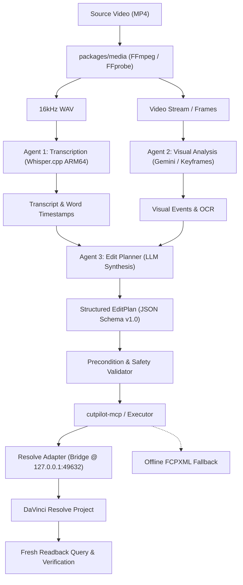

# CutPilot — Canonical Architecture Specification

**Version:** 1.0.0  
**Status:** Approved Architecture Standard  
**Operating Environment:** Windows 11 ARM64 (Qualcomm Snapdragon X2 Plus)  
**Host NLE:** DaVinci Resolve Free 21.0.3.7 via in-app loopback bridge (`127.0.0.1:49632`)  

---

## 1. Architectural Philosophy

CutPilot is an autonomous, model-independent video-editing copilot designed with strict safety boundaries:

1. **Separation of Reasoning and Execution**:
   AI agents propose structured edit plans. AI agents **never** execute raw, unrestricted Resolve API calls directly.
2. **Deterministic, Verifiable Write Operations**:
   Every timeline modification is schema-validated, project-scoped, logged, and verified via post-edit readback queries.
3. **Pluggable Adapter Core**:
   The editing engine communicates through an abstract editing adapter interface. While DaVinci Resolve Free 21.0.3.7 is the primary backend, the core engine also supports offline FCPXML (xmeml v4) and SRT/VTT caption fallbacks.
4. **Zero Environment Pollution**:
   Native ARM64 Python remains the system default. The x64 Python environment required by DaVinci Resolve's `fuscript.exe` is strictly process-scoped.

---

## 2. Multi-Agent System Roles & Boundaries



### Agent 1 — Transcription & Speech Timing
- **Responsibility**: Local audio extraction via FFmpeg and word-level speech recognition via native ARM64 Whisper.cpp (`whisper-cli.exe` with GGML Base model).
- **Output**: Validated `TranscriptResult` with word-level timestamps (`WordTimestamp`), confidence metrics, and silence intervals.
- **Constraints**: No word or segment may end beyond media duration. Raw transcription output is preserved alongside normalized boundaries.

### Agent 2 — Visual Analysis & Understanding
- **Responsibility**: Video understanding, keyframe state extraction, on-screen text (OCR), and visual scene transitions using Gemini Cloud Video API (or local VLM fallback).
- **Output**: Structured `VisualAnalysisResult` containing timestamped `VisualEvent` items with confidence and evidence descriptions.
- **Constraints**: Focuses on major state transitions, slide changes, speaker presence, and readability.

### Agent 3 — Edit Planning & Synthesis
- **Responsibility**: Merging audio transcripts with visual events to propose an optimal cut sequence, trimmable head/tail handles, B-roll insertions, and subtitle cues.
- **Output**: A strictly formatted `EditPlan` adhering to Schema Version `1.0.0`.
- **Safety Gate**: Agent 3 proposes plans only. It does not invoke execution tools directly.

---

## 3. Core Data Contracts & Schemas

All data exchanged between agents, tools, and adapters is governed by versioned models defined in `packages/core/models.py`.

### 3.1 Media Asset Contract
```python
class MediaAsset(BaseModel):
    file_path: str
    file_name: str
    file_size_bytes: int
    duration_seconds: float
    fps: float
    width: int
    height: int
    has_video: bool
    has_audio: bool
    audio_sample_rate: Optional[int]
    audio_channels: Optional[int]
```

### 3.2 Transcript & Word Timestamps
```python
class WordTimestamp(BaseModel):
    word: str
    start: float  # Seconds
    end: float    # Seconds
    confidence: float
    is_speech: bool = True

class TranscriptSegment(BaseModel):
    id: int
    start: float
    end: float
    text: str
    words: List[WordTimestamp]

class TranscriptResult(BaseModel):
    version: str = "1.0.0"
    source_media: str
    duration_seconds: float
    language: str
    segments: List[TranscriptSegment]
```

### 3.3 Visual Events
```python
class VisualEvent(BaseModel):
    id: str
    start_seconds: float
    end_seconds: float
    event_type: str  # "slide_change", "ui_transition", "speaker_gesture", "scene_cut"
    description: str
    on_screen_text: Optional[str]
    confidence: float
    evidence: str

class VisualAnalysisResult(BaseModel):
    version: str = "1.0.0"
    source_media: str
    model_id: str
    events: List[VisualEvent]
```

### 3.4 Edit Decision Plan
```python
class EditAction(BaseModel):
    action_type: Literal["append", "cut", "trim", "caption", "marker"]
    source_clip: str
    start_frame: int
    end_frame: int
    track_type: Literal["video", "audio"] = "video"
    track_index: int = 1
    target_in_frame: Optional[int] = None
    target_out_frame: Optional[int] = None
    caption_text: Optional[str] = None

class EditPlan(BaseModel):
    schema_version: str = "1.0.0"
    project_name: str
    timeline_name: str
    target_fps: float
    source_assets: List[str]
    actions: List[EditAction]
```

---

## 4. `cutpilot-mcp` Server Tool Interface

Our canonical Model Context Protocol server exposes uniform, safe tools for AI orchestrators:

1. `cutpilot_inspect_project`:
   - Inspects the active Resolve project name, timeline count, and media pool contents.
2. `cutpilot_inspect_timeline`:
   - Inspects video/audio tracks, clips, start/end frames, and duration on a specified timeline.
3. `cutpilot_create_project`:
   - Creates a new project in the project library, requiring explicit confirmation if switching away from an unsaved project.
4. `cutpilot_import_media`:
   - Imports verified media files into the project Media Pool.
5. `cutpilot_create_timeline`:
   - Creates a timeline with explicit name and framerate matching source assets.
6. `cutpilot_place_clip`:
   - Appends or inserts a clip slice (`mediaPoolItem`, `startFrame`, `endFrame`) onto a specified track.
7. `cutpilot_generate_captions`:
   - Produces standard SRT or WebVTT files with character-per-second constraints from Agent 1 transcripts.
8. `cutpilot_export_fcpxml`:
   - Generates an offline FCPXML (xmeml v4) timeline file for manual import (`Ctrl+Shift+I`) when Resolve is closed.
9. `cutpilot_verify_timeline`:
   - Performs a readback query comparing the live timeline against the original `EditPlan`.

---

## 5. Resolve Adapter & Safety Protocol

```
Resolve Adapter Architecture:
   [Agent / MCP Tool]
           │
           ▼
   [ResolveBridgeAdapter]
           │
    ┌──────┴──────────────────────────────────────┐
    ▼                                             ▼
[Bridge Client @ 127.0.0.1:49632]    [Direct SQLite Reader (mode=ro)]
(Live Read/Write via fuscript proxy)  (Zero-dependency fallback query)
```

### Pre-Write Invariants
Before issuing any write operation over the bridge:
1. **Target Verification**: `assert pm.GetCurrentProject().GetName() == target_project`. Write operations against unconfirmed or non-target projects are unconditionally refused.
2. **Frame-Rate Alignment**: Source clip frame counts must be translated to timeline frames when fps differs:
   $$\text{Timeline Frames} = \left\lfloor\frac{\text{Source Frame}}{\text{Source FPS}} \times \text{Timeline FPS}\right\rfloor$$
3. **Handle Management**: The bridge LRU handle table is bounded to 4,096 items to ensure zero memory leaks.
4. **Verification Gate**: Every write must be followed by `verify_timeline`. If items do not appear on track or frames do not match, the executor reports a verified failure without retrying blindly.
